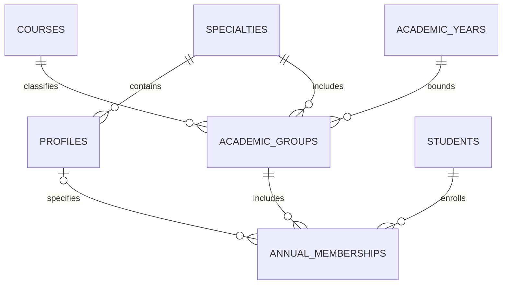

# Доработка Attendance: составы, регистрация и посещаемость

Дата: 19 октября 2026 года.

Статус: дизайн согласован в обсуждении; письменная спецификация подготовлена для проверки перед планом реализации. Продуктовый код и рабочая БД на этом этапе не изменяются.

## 1. Назначение и границы

Преподаватель проводит занятия, сопоставляет предъявленные пропуска с импортированными студентами и исправляет посещаемость при сбое регистрации. Справочник содержит примерно до 300 студентов. Основной сценарий должен выполняться быстро с клавиатуры; мышь также полноценно поддерживается во всех окнах и диалогах. Сочетания клавиш дополняют видимые действия интерфейса.

Приложение остаётся локальным настольным приложением Python/Qt с SQLite, приватным рабочим окном и отдельным публичным экраном. Новые сетевые сервисы, аккаунты и отправка студенческих данных не требуются. Реальные списки остаются у пользователя. В разработке, тестах, демонстрациях и репозитории используются исключительно вымышленные данные. Ни одна БД, включая демонстрационные и резервные копии, не публикуется.

## 2. Формат списка и идентификация

Образец: `examples/demo.csv`. Семь колонок в указанном порядке:

| Колонка | Значение и правила |
| --- | --- |
| Внутренний № по списку | Положительное целое, порядковый номер в исходной ведомости; не ключ студента |
| ФИО | Обязательная строка целиком, с пробелами; не разбивается на компоненты |
| Специальность | Обязательное полное название; разрешается в ссылку на справочник |
| Профилизация | Название профилизации в рамках специальности; пустая ячейка означает отсутствие сведений |
| Курс | Положительное целое; разрешается в ссылку на справочник курсов |
| Группа | Положительный целочисленный номер группы, уникальный только в контексте её учебного года, специальности и курса |
| Номер зачётки | Обязательный идентификатор из ASCII-цифр; хранится как TEXT, ведущие нули значимы |

Файл имеет одну строку заголовков и по одной строке на студента. Заголовок ведомости, дата печати, объединённые ячейки, итоги и пустая восьмая колонка не нужны. Кодировка образца — UTF-8 с BOM, разделитель — точка с запятой, окончания строк — CRLF. Поля CSV с разделителем, кавычкой или переводом строки должны корректно заключаться в кавычки. Поддержка UTF-8, Windows-1251 и явного выбора разделителя сохраняется.

CSV не содержит типов ячеек. При открытии и сохранении в табличном редакторе колонку номера зачётки следует задавать текстовой. `00009012` и `9012` — разные идентификаторы; приложение не должно дополнять или удалять нули по догадке. Курс, группа и порядковый номер, напротив, интерпретируются как целые числа.

Номер зачётки — уникальный внешний ключ сопоставления при импорте. Внутренний `students.id` остаётся неизменяемым техническим ключом: исправление опечатки в номере зачётки не должно менять владельца карточных связей. Для новых студентов создаётся UUID, для существующих сохраняется прежний ID.

Совпадающие ФИО не объединяют записи. Отсутствующий номер зачётки и повтор одного номера внутри файла блокируют применение с указанием строк. Порядковые номера могут начинаться заново в каждой ведомости и не участвуют в объединении студентов.

## 3. Реляционные справочники и годовое зачисление

Названия специальностей, профилизаций и значения курсов не копируются в каждую запись студента. Используются внешние ключи и ограничения уникальности.

| Таблица | Смысл, ключи и связи |
| --- | --- |
| `students` | `id` — неизменяемый PK; `record_book_number TEXT UNIQUE`; `full_name` |
| `academic_years` | PK; уникальный год начала, например 2026 для 2026/27 |
| `courses` | PK; уникальное положительное целое `number` |
| `specialties` | PK; каноническое название и уникальный нормализованный ключ |
| `specialty_aliases` | Уникальный нормализованный ключ канонического названия или псевдонима → `specialty_id`; единая область разрешения имён |
| `profiles` | PK; FK на специальность; название; уникальность нормализованного названия внутри специальности |
| `profile_aliases` | Ключ канонического названия или псевдонима в контексте специальности → `profile_id`; `UNIQUE(specialty_id, normalized_key)` |
| `academic_groups` | PK; FK на учебный год, курс и специальность; номер группы; `variant_key TEXT NOT NULL DEFAULT ''` для явного уточнения неоднозначных групп |
| `annual_memberships` | FK на студента, учебный год, группу и необязательную профилизацию; одно действующее зачисление студента на учебный год |
| `import_batches` | Контекст и итог локального импорта: год, время, хеш файла, состояние |
| `import_rows` | FK на пакет и студента; номер строки CSV и исходный порядковый номер |

Обычный ключ группы: `(academic_year_id, specialty_id, course_id, group_number)`. Поэтому группа 1 на разных курсах или специальностях создаёт разные записи. Для редкого реального совпадения всех четырёх полей допускается явно заданное уточнение группы; полный уникальный ключ включает `variant_key`. У обычной группы уточнение равно пустой строке, а не NULL: повторный импорт не должен обходить уникальность SQLite через NULL. Если по четырём полям CSV найдено несколько групп, импорт требует выбора в предпросмотре. Профилизация не используется как скрытое уточнение группы.

Профилизация относится к годовому зачислению студента. Это допускает несколько профилизаций внутри одной академической группы. Профилизация обязательно принадлежит специальности этой группы. Одинаковые названия профилизаций разных специальностей остаются разными справочными записями.

На уровне хранения проверяются соответствие года зачисления году группы, соответствие специальности профилизации специальности группы и единственность действующего годового зачисления. Используются составные внешние ключи и, где необходимо, триггеры проверки; одной проверки GUI недостаточно.

Учебный год выбирается явно в контексте импорта и виден в предпросмотре. Он отсутствует в CSV и не вычисляется из курса либо даты на компьютере. При переходе на следующий год создаётся новое годовое зачисление и годовое состояние группы. Предыдущий год не переписывается. Для перевода внутри года сохраняется аудит изменения зачисления; снимки уже проведённых пар остаются неизменными.

### 3.1. Разрешение справочников при импорте

Канонические названия и псевдонимы используют единое пространство ключей: при создании справочной записи её канонический ключ также регистрируется в таблице разрешения имён. Ключ не может быть каноническим названием одной записи и псевдонимом другой. Для специальностей ключ уникален глобально; для профилизаций — внутри специальности. Принадлежность цели `profile_aliases` указанной специальности проверяется составным внешним ключом. Эти правила соблюдаются при импорте, добавлении псевдонима и переименовании; коллизия блокирует изменение. Поиск точного соответствия выполняется через эту общую область разрешения имён.

1. Нормализовать Unicode в NFC, убрать краевые и повторные Unicode-пробелы, применить `casefold` для ключа сравнения. Отображаемое каноническое название хранится отдельно.
2. Найти специальность по точному нормализованному имени или явному псевдониму. Затем найти профилизацию в контексте этой специальности.
3. Разрешить курс по числу, группу по контекстному ключу и студента по номеру зачётки.
4. Показать предпросмотр: новые справочники и группы, новые студенты, исправления ФИО, изменения зачисления, неизменившиеся записи и конфликты.
5. Непривычное написание или опечатка предлагается как новая справочная запись либо явно сопоставляется существующей с сохранением псевдонима. Нечёткое сравнение, транслитерация, удаление пунктуации и замена `ё` на `е` не объединяют справочники автоматически.
6. Проверить весь план и применить одной транзакцией. При конфликте состояния после предпросмотра повторить проверку, а не применять устаревший план.

Повторный импорт того же содержимого использует те же FK и не создаёт дублей. Отсутствующие в файле студенты не удаляются и не исключаются из составов. Импорт списка не создаёт посещений и не назначает студентов прошлым занятиям.

## 4. Дисциплины и семестровые составы

Дисциплина зачисляет целые академические группы выбранного года. Для повторяющихся занятий создаются учебные составы конкретной дисциплины на семестр. Лабораторные составы зависят от дисциплины; общей для всех предметов подгруппы не предполагается.

| Пример | Состав | Длительность |
| --- | --- | --- |
| Java, лекции | Несколько целых групп одного курса; специальности могут различаться | Одна пара |
| Java, лабораторные | Сохранённый список части одной группы | Две последовательные пары |
| Кибербезопасность, семинары | Одна целая группа | Одна пара |

Основные связи: `discipline_groups`, `teaching_rosters`, `roster_groups`, `roster_students`. Учебный состав знает дисциплину, год, семестр, вид занятия и длительность. Режимы состава: целые группы либо выбранные студенты ровно одной группы. Все группы одного состава принадлежат одному курсу и учебному году. Составы второго семестра можно создать копированием первого и затем перераспределить студентов в копии.

Каждая конкретная пара сохраняет собственный снимок ожидаемых студентов и их академического контекста. Изменение справочника или семестрового состава влияет на будущие незафиксированные пары. Изменение исторического снимка — отдельное действие с аудитом. Студент вне ожидаемого состава может иметь реальное присутствие, сохраняя отметку «вне состава».

## 5. Расписание, блоки и пары

Используются следующие локальные слоты:

| № | Начало | Конец |
| --- | --- | --- |
| 1 | 09:00 | 10:20 |
| 2 | 10:30 | 11:50 |
| 3 | 12:00 | 13:20 |
| 4 | 13:50 | 15:10 |
| 5 | 15:20 | 16:40 |
| 6 | 17:00 | 18:20 |
| 7 | 18:30 | 19:50 |
| 8 | 20:00 | 21:20 |

`scheduled_blocks` объединяет одну или две записи пар (`lessons`). У пары собственные ID, снимок состава, журнал и итог посещения. Лабораторный блок занимает два последовательных номера слотов, включая перерыв между ними; он не может начинаться с восьмого слота. Время каждой пары хранится явно с часовым поясом, по умолчанию Europe/Minsk.

Основной путь — выбрать занятие в расписании и открыть регистрацию. Сохраняется быстрое создание на лету: выбрать учебный состав, дату и начальный слот; длительность берётся из состава. Дата по умолчанию сегодняшняя и видна до создания. Произвольные часы и минуты в обычном сценарии не вводятся.

## 6. Сеанс регистрации и основания присутствия

Сеанс регистрации (`registration_sessions`) относится к одному блоку. Его охват (`session_target_pairs`) — одна пара либо обе пары блока. Охват задаётся явно и не выводится из текущего времени. Открытие, продолжение и завершение контролируются оператором.

Карточные проверки (`card_evidence`) хранят исходный сеанс, UID и фактическое время. Новая таблица не смешивает разные сеансы одной пары. Неизвестные карты сохраняются до идентификации. Обработка очереди сохраняет исходный `session_id`, даже если оператор переключил регистрацию.

Команда «Охват регистрации: весь блок» расширяет выбранный сеанс с записью `session_scope_changes`. Все его прежние и последующие проверки подтверждают обе пары, даже если единственная проверка была во время второй пары. Поздняя привязка неизвестной карты использует тот же охват. Время не подменяется, искусственные повторные считывания не создаются. Охват соседних сеансов не меняется.

Ручная отметка из быстрого поиска использует явно показанный сеанс и охват. Исторические ручные исправления, напротив, имеют фиксированные цели `(student_id, pair_id)` и не расширяются при изменении охвата сеанса.

Итоговое присутствие на пару — объединение действующих карточных и ручных оснований, включая сохранённые данные прежней версии. Несколько оснований дают одно присутствие на студента и пару. Время ручного внесения обозначается временем подтверждения, а не временем предъявления карты или достоверным временем прибытия.

## 7. Рабочие окна и команды

Одно приватное главное окно содержит четыре раздела:

1. **Занятие:** сегодняшнее расписание, таблица студентов текущего блока, очередь неизвестных карт, поиск и сопоставление, ручная отметка, встроенный журнал.
2. **Подготовка:** импорт, справочники, группы, дисциплины, семестровые составы и расписание.
3. **Посещаемость:** матрица за период, выделение ячеек, ручные исправления, история оснований, экспорт.
4. **Устройство и данные:** считыватель, публичный монитор, резервирование и восстановление.

Постоянная панель показывает активную регистрацию, блок, пары, состав, охват и устройство. «Открыть» и «Завершить» расположены рядом. Просматриваемое занятие и активная регистрация — разные состояния. Просмотр другого занятия не переключает поток регистрации. Отдельным постоянным окном остаётся публичный экран. Детали посещения показываются в боковой панели с сохранением выделения таблицы.

Короткие диалоги: создание и редактирование блока; ручная отметка; исправление привязки; редактирование студента или состава; импорт с предпросмотром; массовый зачёт; экспорт; переключение регистрации; восстановление БД. Все действия доступны мышью, через стандартный обход фокуса и через список команд.

| Клавиши | Действие |
| --- | --- |
| F1 | Поиск доступных команд с контекстом и сочетаниями |
| F2 | Быстрая ручная отметка в явно показанной активной регистрации |
| F3 | Поиск текущего экрана |
| F6 / Shift+F6 | Следующая / предыдущая область |
| F9 / Shift+F9 | Открыть / завершить регистрацию; это отдельные команды |
| Tab / Shift+Tab | Стандартный переход между элементами |
| Стрелки / Space | Навигация и выбор в списках и таблицах |
| Enter | Выбор найденного студента, открытие деталей или видимая основная команда текущего диалога |
| Ctrl+Enter | Контекстная команда сохранения или массового зачёта |
| Esc | Отмена текущего диалога или незавершённого действия |

Основные функциональные клавиши работают независимо от раскладки. Горячие клавиши приватного окна не срабатывают в публичном окне и под модальным диалогом. В полях ввода сохраняются обычные команды редактирования текста. Все кнопки, меню, заголовки сортировки и массовые действия остаются доступны мышью.

## 8. Поиск, очередь и отзывчивость

Справочник и подготовленные поисковые строки кешируются в памяти. Ввод обновляет список кандидатов без SQL на каждый символ и без перестроения остальных экранов. Курс — основной контекст; список показывает ФИО, группу, подгруппу, специальность и номер зачётки. Приоритет у состава выбранного занятия; расширение области поиска видно оператору.

Поиск учитывает регистр, пробелы, `ё/е`, порядок слов, части имени и опечатки. Это удобство поиска кандидатов, а не способ автоматического объединения справочников или студентов. Похожесть имени не создаёт привязку без явной команды оператора.

Текущая карта закрепляется до успешного сопоставления или явного откладывания. Новые карты сохраняются и попадают в очередь; повтор одной карты не создаёт второе задание. Известные карты отмечаются без вмешательства. События не меняют запрос, фокус, выделение и прокрутку. Ручной поиск имеет отдельный черновик и после закрытия восстанавливает прежнее состояние сопоставления.

Цели измерений: поиск на 300 студентах p95 не более 50 мс; отображение сохранённой проверки не более 150 мс после получения UID в нормальном режиме. До реализации это критерии приёмки, а не достигнутые показатели.

## 9. Таблицы, выделение и массовые отметки

Таблица текущего блока: ФИО, номер зачётки, группа, подгруппа, специальность и одна либо две колонки пар. Выделяются строки: Shift со стрелками или щелчком расширяет диапазон; Ctrl+Space или Ctrl+щелчок переключает отдельные строки. «Зачесть выбранным обе пары» создаёт ручные подтверждения для выбранных студентов во всех парах показанного блока.

Общая матрица: строки студентов и колонки отдельных пар с объединяющими заголовками блоков. Shift со стрелками или щелчком расширяет прямоугольник; мышью можно протянуть диапазон. «Зачесть выделенные отметки» действует на точные выбранные ячейки прошедших занятий. Выделение первой пары блока не распространяется на вторую.

Обе операции фиксируют явные пары `(student_id, pair_id)` в пакете ручных подтверждений. Предпросмотр показывает дисциплину, даты, пары, число студентов, число отметок и основание. Уже действующее ручное подтверждение повторно не добавляется. Подтверждение выбранной ячейки с карточным основанием сохраняет независимое ручное основание; итоговое присутствие не удваивается. Отмена пакета отзывает только созданные им основания и сохраняет остальные.

Сортировка: ФИО, группа, подгруппа, специальность; доступны направление и несколько последовательных полей. Номера групп сортируются численно; равные значения упорядочиваются по ФИО и номеру зачётки. Подгруппа относится к выбранной дисциплине и семестру, а не к студенту вообще. Отсутствующая подгруппа отображается как «—».

Выделение хранится по устойчивым ID. При сортировке сохраняется точный набор студентов и пар; прямоугольник может стать несколькими раздельными участками. Смена периода, дисциплины или фильтра сбрасывает выделение с обновлением счётчика. Выбранные невидимые строки не становятся скрытыми получателями команды. Новые считывания не меняют порядок, якорь или выделение редактируемой таблицы.

Для таблиц нужны отдельные модели данных и сортирующие представления. Один общий обработчик команд должен обслуживать меню, клавиатуру и мышь. Обновления адресуются затронутым строкам, очереди и счётчикам; глобальное перестроение всех экранов на каждое событие исключается.

## 10. Оформление БГУ

Приватные окна используют светлую тему, белые рабочие поверхности и палитру предоставленного брендбука: тёмно-синий `#0A3470`, синий `#144E9D`, светло-синий `#3076AF`, голубой `#7BB8BF`, охра `#D9CBA0`. Для интерфейса используется Arial как разрешённая замена Helvetica Light. Готовый логотип сохраняет пропорции и охранное поле; Neutra Text SC не применяется к обычному тексту интерфейса.

Фокус клавиатуры отчётливо виден. Статусы различаются текстом и обозначением, а не только цветом. Публичный экран сохраняет крупные подтверждения и скрывает ФИО по таймеру; технические сведения и UID на него не передаются. Брендбук и реальные студенческие материалы в репозиторий не копируются.

## 11. Миграция и проверка

Изменения схемы выполняются локально после согласованной резервной копии и в транзакции. Сохраняются старые `students.id`, все ID занятий, карточные связи, исходные UID и времена. Текст старой группы и прежний ID не превращаются в справочники или номер зачётки по догадке. Для мигрированных записей номер зачётки временно допускает NULL до явного сопоставления; для нового официального импорта он обязателен.

Существующие `scans` сохраняются как источник прежних регистраций. Новые проверки по сеансам хранятся отдельно: ключ `(lesson_id, uid)` прежней таблицы не выражает несколько сеансов одной пары. Отчёты объединяют старые и новые основания.

Историческим занятиям не назначаются автоматически новые составы и слоты. Пустые зафиксированные составы сохраняются пустыми. Восстановление старой резервной копии включает проверяемую миграцию в новую схему, а не безусловное отклонение только из-за прежней версии.

Приёмка включает: повторный импорт без новых сущностей; годовой переход без изменения прошлого; разные профилизации одной группы; повторяющиеся номера групп разных курсов и специальностей; тёзки; ведущие нули номера зачётки; отказ всего импорта при конфликте; два независимых результата лабораторной и расширение охвата на весь блок; позднюю привязку неизвестной карты; ручную отметку и отмену пакета; сохранение целей после сортировки; оба способа выделения; полное прохождение сценариев клавиатурой и мышью; устойчивый фокус при новых сканированиях; приватность публичного экрана.

В рамках подготовки этой спецификации допустимы только синтетический CSV, документация и их проверка. План реализации составляется после проверки письменной спецификации; продуктовая реализация и миграция рабочей БД выполняются отдельным этапом.
